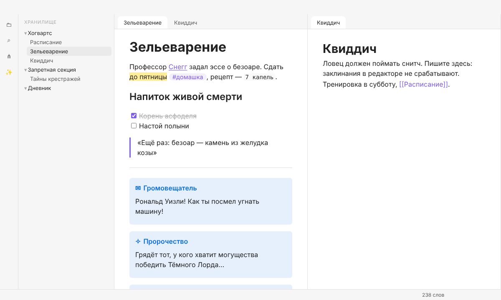
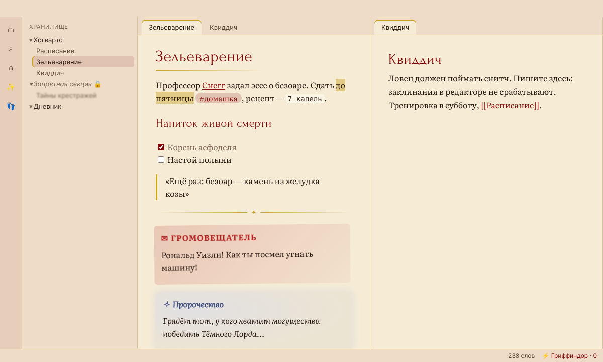
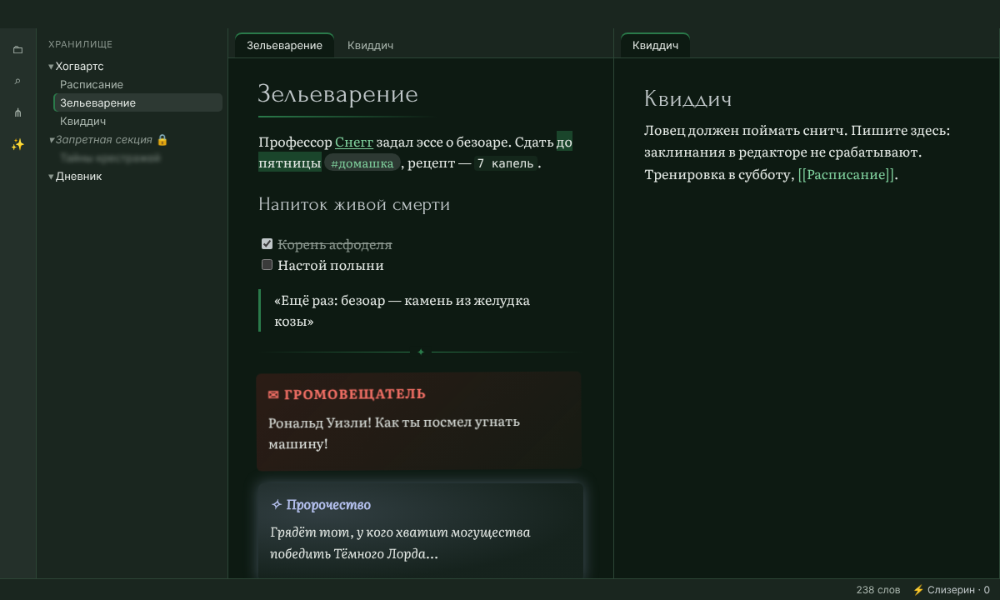
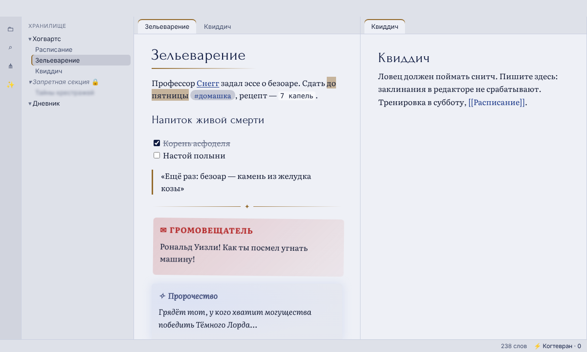
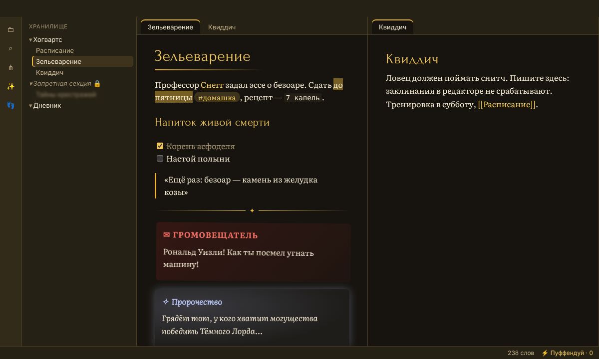
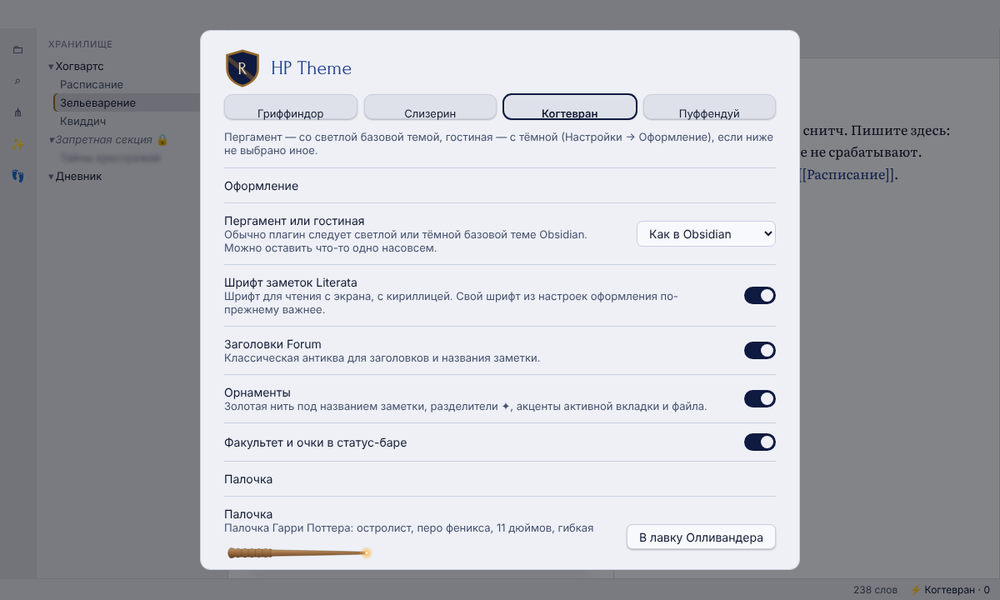
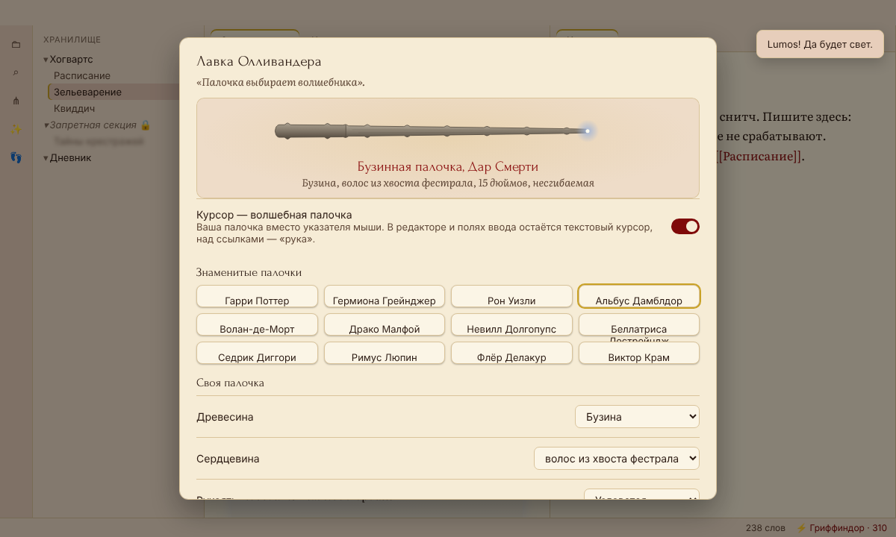
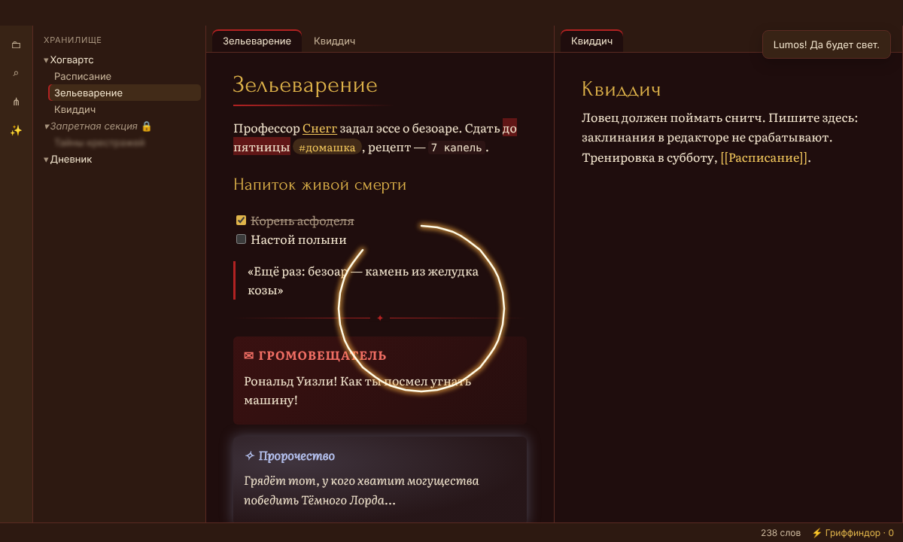

# HP Theme для Obsidian

Плагин Obsidian, который оформляет хранилище в стиле факультетов Хогвартса.

- **Все четыре факультета**: Гриффиндор, Слизерин, Когтевран, Пуффендуй.
- **Два режима у каждого**: «Пергамент» в светлой теме Obsidian и «Гостиная» в тёмной.
- **Читаемые шрифты**: текст заметок набран Literata (шрифт для чтения с экрана), заголовки — Forum (классическая антиква). У обоих есть кириллица, оба встроены в `styles.css`. Интерфейс остаётся на системном шрифте, код не меняется, а шрифт из «Настройки → Оформление» по-прежнему важнее шрифта темы.
- **Контраст**: основной текст ≥ 7:1 на всех фонах (заметка, панели, выделение), заголовки, ссылки и второстепенный текст ≥ 4.5:1. Это проверяют тесты.
- **Своя палочка**: двенадцать палочек из книг и фильмов (Гарри, Гермиона, Рон, Бузинная палочка, Волан-де-Морт и другие) или собственная — из древесины, сердцевины, рукояти, длины и гибкости. Палочка видна в курсоре, а её сердцевина задаёт цвет магии.
- **Заклинания движениями палочки**: зажмите правую кнопку мыши и нарисуйте фигуру. Отключается в настройках.
- **Пасхалки**: описаны ниже, под спойлером.

| Обычный Obsidian | Гриффиндор, пергамент | Слизерин, гостиная |
|---|---|---|
|  |  |  |
| **Когтевран, пергамент** | **Пуффендуй, гостиная** | **Настройки** |
|  |  |  |

## Установка

1. Соберите плагин (`npm install && npm run build`) или возьмите готовые `main.js`, `manifest.json` и `styles.css` из корня репозитория.
2. Скопируйте эти три файла в папку `<хранилище>/.obsidian/plugins/hp-theme/`.
3. В Obsidian: «Настройки → Сторонние плагины», включите **HP Theme**.

`npm run pack` собирает архив `dist/hp-theme-<версия>.zip` с этими тремя файлами.

Лучше всего плагин выглядит со стандартной темой Obsidian: сторонние темы тоже переопределяют цвета и могут с ним конфликтовать.

## Как пользоваться

- **Факультет** выбирается в настройках плагина, в меню по клику на палочку в ленте или на факультет в статус-баре, а также командой «Выбрать факультет».
- **Пергамент или гостиная** зависят от светлой или тёмной темы Obsidian («Настройки → Оформление»).
- В настройках отдельно включаются шрифты, орнаменты (золотая нить под названием заметки, разделители ✦, акценты активной вкладки и файла), курсор-палочка, факультет в статус-баре, магия и заклинания движениями палочки.

### Лавка Олливандера

Палочка выбирается в лавке Олливандера: кнопка в настройках, пункт меню палочки в ленте или команда «Лавка Олливандера: выбрать палочку».

- **Знаменитые палочки**: древесина, сердцевина и длина взяты из книг и Pottermore, форма рукояти — по палочкам из фильмов. Например, у Гарри остролист, перо феникса и 11 дюймов, у Гермионы виноградная лоза, сердечная жила дракона и 10¾ дюйма, у Бузинной палочки бузина, волос из хвоста фестрала и 15 дюймов.
- **Своя палочка**: 15 пород дерева, 5 сердцевин, 6 рукоятей (гладкая, с кольцами, резная лоза, узловатая, костяной коготь, навершие-шар), длина от 8 до 16 дюймов с шагом ¼ и 6 степеней гибкости. Кнопка «Пусть палочка выберет сама» собирает случайную.
- Палочка заменяет указатель мыши везде, в том числе над заметками. В полях ввода остаётся текстовый курсор, над ссылками — «рука». Курсор включён по умолчанию, а выключить его можно в настройках или прямо в лавке (выбор палочки включает его снова). Ещё палочка видна в настройках. Сердцевина задаёт цвет следа и искр: у пера феникса золотой, у жилы дракона алый, у волоса единорога серебристый.

| Лавка Олливандера | След палочки |
|---|---|
|  |  |

### Заклинания движениями палочки

Зажмите правую кнопку мыши, нарисуйте фигуру и отпустите кнопку. Пока вы рисуете, за курсором тянется светящийся след. Если фигура узнана, вылетают искры, а если нет, след гаснет. Обычный правый клик без движения по-прежнему открывает контекстное меню. Какие фигуры рисовать, написано в «Стандартной книге заклинаний» в настройках (под спойлером) и ниже, в пасхалках.

Жесты работают при включённой магии. Отключить только их можно переключателем «Заклинания движениями палочки».

На macOS и Linux контекстное меню открывается при нажатии кнопки, а не при отпускании. Поэтому вне текста плагин открывает его, когда кнопку отпустили без жеста. В тексте заметки и в полях ввода меню открывается сразу, как обычно (с подсказками орфографии), и жест там начать нельзя: рисуйте на боковой панели, на вкладках или в режиме чтения. На Windows жесты работают везде.

<details>
<summary><b>Пасхалки (спойлеры!)</b></summary>

Заклинания набираются на клавиатуре в любом месте **вне редактора**: в проводнике, в режиме чтения и т.п. Их можно произнести и через команду «Взмахнуть палочкой…» или нарисовать палочкой (правой кнопкой мыши). Набирать можно и по-английски, и по-русски.

| Заклинание | Движение палочкой | Что происходит |
|---|---|---|
| `lumos` / `люмос` | Штрих вверх | Вспышка света, Obsidian переключается на светлую тему |
| `nox` / `нокс` | Штрих вниз | Свет гаснет, включается тёмная тема |
| `wingardium leviosa` / `вингардиум левиоса` | «Взмах и щелчок»: дуга вниз и вверх, затем короткий взмах вниз | То, на что указала палочка (абзац, файл, вкладка), взлетает и покачивается в воздухе. Леви-О-са, а не Левио-СА! |
| `I solemnly swear that I am up to no good` / `Клянусь, что замышляю только шалость` | Буква M (Мародёры) | По окну бегут следы с Карты Мародёров, появляется надпись Лунатика, Хвоста, Бродяги и Сохатого |
| `mischief managed` / `шалость удалась` | Туда-обратно, будто стираете карту | Тема гаснет до новой клятвы или перезапуска |
| `accio snitch` / `акцио снитч` или код Konami ↑↑↓↓←→←→BA | Круг в любую сторону | Прилетает Золотой снитч. Если поймать его кликом, факультет получает +150 очков (видно в статус-баре) |

Секретные коллауты:

```markdown
> [!howler] Громовещатель
> Трясётся при появлении.

> [!prophecy] Пророчество
> Светится, как стеклянный шар.

> [!marauders] Карта Мародёров
> Пергамент и чернила.
```

Ещё несколько секретов:
- Папка «Restricted Section» или «Запретная секция» показывается курсивом и с замком, её содержимое размыто, пока на него не наведёшь курсор.
- Распределяющая шляпа доступна командой, кнопкой в настройках и пунктом меню.
- Тройной клик по гербу в настройках открывает девиз *Draco dormiens nunquam titillandus*.
- 31 июля плагин поздравляет Гарри с днём рождения.

Если включено «уменьшение движения», анимации отключаются.
</details>

## Разработка

```bash
npm install
npm run build        # main.js + styles.css (+ docs/mockups/tokens.js)
npm run dev          # пересборка main.js при изменениях
npm run typecheck
npm test             # юнит-тесты: контраст палитр, CSS, заклинания, жесты, палочки, переводы, настройки, манифест
npm run test:e2e     # e2e на тестовом стенде (нужен Playwright с Chromium)
npm run screenshots  # обновить docs/screenshots
npm run mockups      # обновить PNG макетов
```

```
src/
  main.ts          класс плагина: классы на <body>, команды, меню, статус-бар, пасхалки
  houses.ts        палитры факультетов — единый источник цветов
  css.ts           палитры → CSS-переменные Obsidian
  styles/theme.css отображение на переменные Obsidian, шрифты, орнаменты, коллауты, эффекты
  settings.ts      вкладка настроек; settings-data.ts — значения по умолчанию
  modals.ts        Распределяющая шляпа, лавка Олливандера, «Взмахнуть палочкой», выбор факультета
  wands.ts         палочки: канонические, детали, SVG для курсора и превью
  gestures.ts      распознавание фигур, нарисованных мышью; gesture-input.ts — правая кнопка и контекстное меню
  effects.ts       вспышка, тьма, следы, снитч, след палочки, левитация
  spells.ts        распознавание заклинаний; i18n.ts — русский и английский
fonts/             Literata и Forum (SIL OFL 1.1)
docs/mockups/      макеты (сделаны до реализации)
docs/screenshots/  скриншоты со стенда
harness/           тестовый стенд: разметка как у Obsidian + заглушка API obsidian
tests/             юнит- и e2e-тесты
```

**О тестовом стенде.** E2E-тесты запускают настоящий код плагина и `styles.css` в Chromium. Вместо Obsidian используются разметка с теми же классами и переменными и заглушка API (`harness/`). Это проверяет логику, цвета, шрифты и пасхалки, но не заменяет проверку в самом Obsidian.

Шрифты Literata и Forum распространяются по лицензии SIL Open Font License 1.1 (`fonts/LICENSE-*.txt`). Harry Potter — торговая марка Warner Bros. и J.K. Rowling; это фанатский проект без коммерческих целей.
