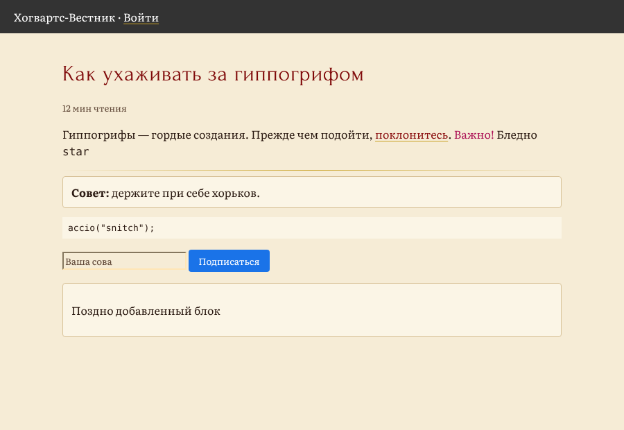
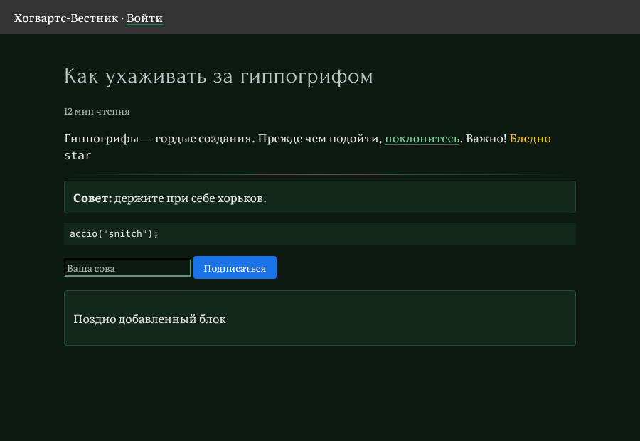
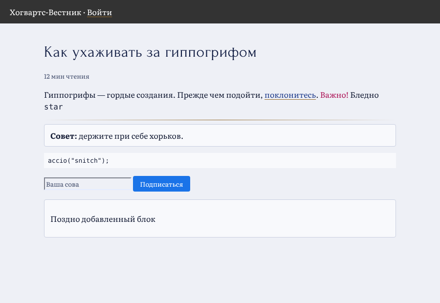
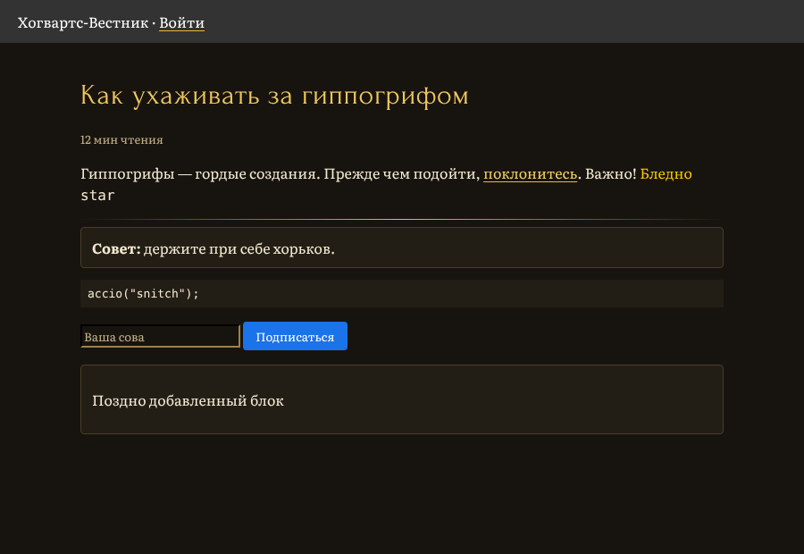
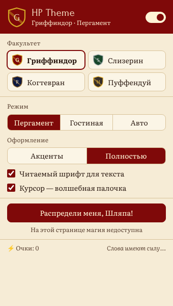

# hp-plugin — HP Theme

Браузерное расширение (Chrome / Edge / Firefox, Manifest V3), которое перекрашивает любые сайты в стиле Хогвартса.

- **Все четыре факультета**: Гриффиндор, Слизерин, Когтевран, Пуффендуй.
- **Два режима** на каждый факультет: светлый «Пергамент» и тёмная «Гостиная», плюс «Авто» по системной теме.
- **Два уровня оформления**: «Акценты» (заголовки, выделение, скроллбар, фокус) и «Полностью» (фон, текст, ссылки, блоки, поля ввода).
- **Читаемые шрифты**: текст набирается Literata (шрифт для чтения с экрана), заголовки — Forum (классическая антиква). У обоих есть кириллица, оба лежат в расширении. Код и иконочные шрифты не меняются.
- **Пасхалки**: см. ниже, под спойлером.

| До | Гриффиндор, пергамент | Слизерин, гостиная |
|---|---|---|
|  |  |  |
| **Когтевран, пергамент** | **Пуффендуй, гостиная** | **Попап** |
|  |  |  |

## Установка

**Chrome / Edge / Яндекс Браузер**
1. Откройте `chrome://extensions`, включите «Режим разработчика».
2. «Загрузить распакованное расширение» → выберите папку `extension/`.

**Firefox**
1. Откройте `about:debugging#/runtime/this-firefox`.
2. «Загрузить временное дополнение» → выберите `extension/manifest.json`.

Готовый архив для магазинов: `npm run pack` → `dist/hp-theme-<версия>.zip`.

## Как это работает

1. **Макеты** — `docs/mockups/index.html` (и PNG рядом): принципы, палитры с коэффициентами контраста, типографика, попап, страница «до/после», пасхалки. Реализация сделана по ним.
2. **Токены** — `extension/shared/houses.js`: единый источник палитр. Тест `tests/palettes.test.js` проверяет, что контраст основного текста ≥ 7:1 (WCAG AAA), а заголовков, ссылок и второстепенного текста ≥ 4.5:1 (AA) во всех 8 палитрах.
3. **Тема** — `extension/content/theme.js` + `theme.css`. В режиме «Полностью» скрипт размечает элементы страницы:
   - светлые нейтральные фоны (белый, светло-серый) → пергамент / поверхность факультета;
   - тёмный нейтральный текст → цвет текста темы, серый → второстепенный, заголовки → основной цвет факультета;
   - цветные брендовые блоки, картинки, тёмные шапки остаются как были;
   - цветной текст остаётся, только если он читается на новом фоне (иначе заменяется цветом текста);
   - динамически добавленные блоки подхватываются через `MutationObserver`.
4. **Попап** — `extension/popup/`: выбор факультета, режимов, шрифта, курсора; Распределяющая шляпа; «Не колдовать на этом сайте».

Расширению нужно только разрешение `storage`; данные никуда не отправляются.

<details>
<summary><b>Пасхалки (спойлеры!)</b></summary>

Заклинания набираются на клавиатуре в любом месте страницы, кроме полей ввода. Работают и по-английски, и по-русски.

| Заклинание | Что происходит |
|---|---|
| `lumos` / `люмос` | Вспышка света от курсора, включается «Пергамент» |
| `nox` / `нокс` | Свет гаснет, включается «Гостиная» |
| `I solemnly swear that I am up to no good` / `Клянусь, что замышляю только шалость` | По странице бегут следы с Карты Мародёров, появляется надпись Лунатика, Хвоста, Бродяги и Сохатого |
| `mischief managed` / `шалость удалась` | Тема гаснет на вкладке до перезагрузки (или до новой клятвы) |
| `accio snitch` / `акцио снитч` или код Konami ↑↑↓↓←→←→BA | Прилетает Золотой снитч. Поймайте его кликом — +150 очков факультету (счёт в попапе) |
| Кнопка «Распредели меня, Шляпа!» | Шляпа размышляет вслух и выбирает факультет |
| Тройной клик по гербу в попапе | Девиз Хогвартса: *Draco dormiens nunquam titillandus* |
| 31 июля | Поздравление с днём рождения Гарри |

Все анимации укорачиваются или отключаются при `prefers-reduced-motion`.
</details>

## Разработка

```bash
npm test             # юнит-тесты: палитры (контраст), разбор цветов, распознавание заклинаний
npm run test:e2e     # e2e в Chromium через Playwright: тема, факультеты, пасхалки, попап
npm run screenshots  # обновить docs/screenshots
npm run icons        # перегенерировать иконки из shared/crest.js
npm run pack         # zip для Chrome Web Store / AMO
```

e2e-тесты и скрипты скриншотов требуют установленного Playwright с Chromium; без него e2e пропускаются.

```
extension/
  manifest.json
  shared/    houses.js (палитры), colors.js, spells.js, crest.js
  content/   theme.js, theme.css, easter-eggs.js
  popup/     popup.html, popup.css, popup.js
  fonts/     Literata, Forum (SIL OFL 1.1)
  _locales/  ru, en
docs/mockups/      макеты
docs/screenshots/  скриншоты реализации
tests/             юнит- и e2e-тесты
```

Шрифты Literata и Forum распространяются по лицензии SIL Open Font License 1.1 (`extension/fonts/LICENSE-*.txt`). Harry Potter — торговая марка Warner Bros. и J.K. Rowling; это фанатский проект без коммерческих целей.
